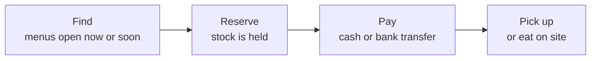
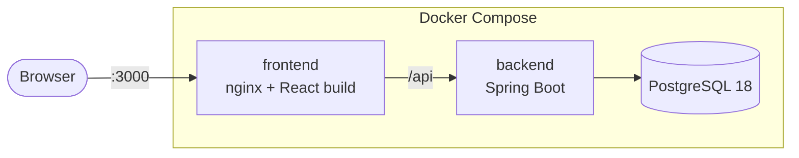
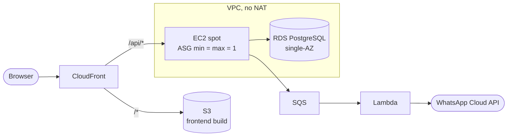
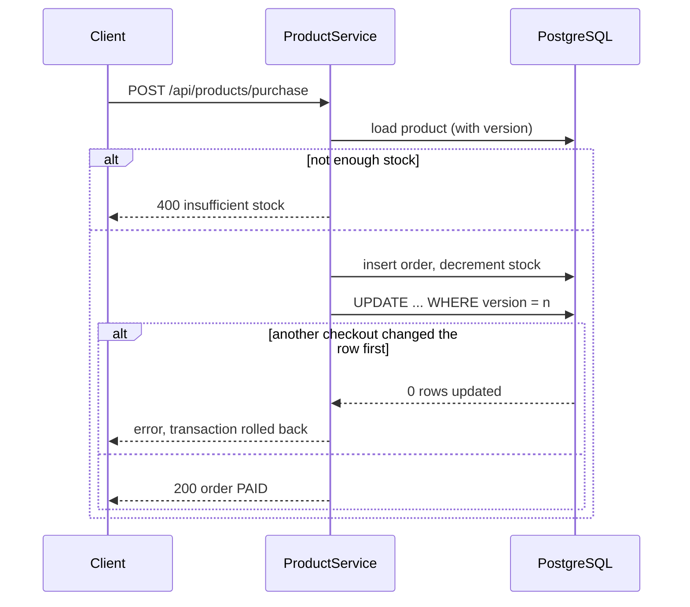

# itacatl

[](https://github.com/landoicco/itacatl/actions/workflows/ci.yml)
[](LICENSE)

A marketplace where small Mexican food businesses (*fondas*, *neverías*, *pulquerías*) publish dynamic menus with limited stock, and customers reserve food for pickup before it sells out.

> *Itacatl* is Nahuatl for the food you carry for the road, the root of the Mexican Spanish *itacate*.

## Status

This is a work in progress, built in the open.

- **Today:** a product catalog with CRUD and a transactional checkout, running locally with Docker Compose and covered by CI.
- **In progress:** the rework into the multi-tenant marketplace described in the [product spec](docs/product-spec.md), and the AWS infrastructure in Terraform described in the [infra plan](docs/infra-plan.md).

| Milestone | State |
|---|---|
| PostgreSQL, CI, ruleset on `main`, hardened containers | ✅ Done |
| Internationalization foundation (`en`, `es-MX`) | ✅ Done |
| Marketplace domain: businesses, menus, reservations | 🚧 Next |
| Terraform: bootstrap, modules, CI/CD | 📋 Planned |
| Ephemeral AWS deploy with load test and recovery evidence | 📋 Planned |

## Product

Businesses publish a menu for a specific service (a date and a time window) with limited stock per item. Customers follow one flow:



What makes it different from a generic store is that menus are **dynamic**: they belong to a service window and run out. One deployment is one marketplace for one vertical (fondas, neverías…), and the vertical is configuration, not code.

## Built for translation

The codebase is in English; the first deployment serves Mexican users in Spanish. Internationalization is a design rule, not an afterthought:

- No hardcoded UI text: every string lives in a per-locale catalog (`en`, `es-MX`) in `frontend/src/i18n/locales/`.
- Translation keys are type-checked against the English catalog, so a typo fails the build; a test fails CI when another locale is missing a key or a placeholder.
- Prices and units go through `Intl` formatters, never string concatenation.
- The default language is set per deployment with `VITE_DEFAULT_LOCALE` (`en` when unset); users can switch, and the choice is remembered.
- The API will return stable error codes instead of sentences, so the client translates them (with the new orders API).

How it works and how to extend it: [i18n guide](docs/i18n.md).

## Architecture

### Local

Compose runs the same images that would run in AWS. nginx plays the role CloudFront has in production: it serves the frontend build and forwards `/api` on the same origin.



### AWS (planned)

A single low-cost production environment, deploy-ready but kept off: validated on every PR and applied only to capture evidence. Estimated at ~$25/month if left running. Design in [ADR 0002](docs/adr/0002-low-cost-production-architecture.md).



## Engineering highlights

- **Concurrency-safe checkout:** optimistic locking (`@Version`) keeps concurrent purchases from pushing stock below zero.
- **Real database in tests:** integration tests run against PostgreSQL in Testcontainers, which also validates every Flyway migration.
- **One image, every environment:** Spring profiles `local` and `aws` change configuration only; the `aws` profile logs ECS JSON for CloudWatch.
- **Hardened containers:** non-root users and memory budgets sized for a 2 GiB instance.
- **Guarded `main`:** CI (format, lint, tests, image builds) is required by a ruleset; actions are pinned to commit SHAs and kept current by Dependabot.
- **Reproducible toolchain:** JDK, Maven and Node are pinned in a Nix flake.

The checkout, step by step:



## Stack

- **Backend:** Java 21, Spring Boot 4, JPA, Flyway, Maven
- **Frontend:** React 19, TypeScript, Vite, Tailwind CSS, Vitest
- **Database:** PostgreSQL 18
- **Infrastructure:** Docker Compose today; AWS with Terraform planned

## Run locally

Requires Docker with Compose v2.

```shell
cp .env.example .env
docker compose up --build
```

Compose starts the database, then the backend, then the frontend, each waiting for the previous one to be healthy. The app runs at `http://localhost:3000` and the API at `http://localhost:8080`. At startup the backend seeds the catalog from `backend/src/main/resources/products.csv`.

The database has no persistent volume, so data resets when the containers are removed:

```shell
docker compose down
```

## API

| Method | Path | Description |
|---|---|---|
| `GET` | `/api/products` | All products |
| `GET` | `/api/products/catalog` | Paginated, filterable catalog used by the frontend |
| `POST` | `/api/products` | Create a product |
| `PUT` | `/api/products/edit/{id}` | Update a product |
| `DELETE` | `/api/products/delete/{id}` | Delete a product |
| `POST` | `/api/products/purchase` | Buy a quantity of a product |

A purchase of exactly 99 units simulates a declined payment, which is useful for testing the error flow.

## Development

The toolchain (JDK, Maven, Node) is pinned in `flake.nix`. Run `nix develop` to enter it.

```shell
# backend/
mvn verify          # format check, build, unit and integration tests
mvn spotless:apply  # format Java and pom.xml

# frontend/
npm ci
npm run lint && npm test -- --run && npm run build
```

Every pull request updates the documentation it affects, so `main` and its docs stay consistent.

## Documentation

| Document | Contents |
|---|---|
| [Product spec](docs/product-spec.md) | Scope, domain rules, order flow, internationalization |
| [Infra plan](docs/infra-plan.md) | AWS architecture, cost rules, work phases |
| [i18n guide](docs/i18n.md) | How translations are wired in, safety nets, adding a text or a language |
| [ADRs](docs/adr/) | Architecture decisions and their trade-offs |

## Layout

```
backend/    Spring Boot API
frontend/   React app
docs/       product spec, infra plan, ADRs (docs/adr/)
```

## License

[MIT](LICENSE)
