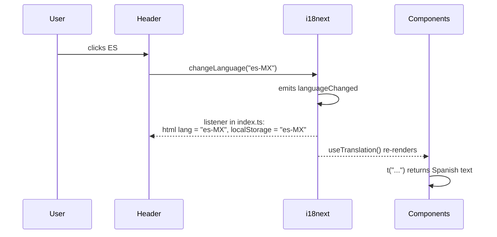

# Internationalization (i18n)

How the frontend handles languages: why it is built this way, how the pieces connect, and how to extend it. The product rules live in the [product spec](product-spec.md#internationalization).

## Why

The codebase is in English, because it is read by developers anywhere; the deployment is used by Mexican customers and businesses, in Spanish. Retrofitting translations after many screens exist is expensive, so the rule applies from the start: **nothing a user reads is hardcoded**.

## Tools

- **[i18next](https://www.i18next.com/):** the translation engine. It stores the catalogs, resolves keys, interpolates values and picks plural forms. It is framework-agnostic and the most widely used i18n library in JavaScript.
- **[react-i18next](https://react.i18next.com/):** the React binding. The `useTranslation()` hook gives components the `t` function and re-renders them when the language changes.
- **`Intl`** (built into the browser): number, currency, unit and plural rules per locale, so no formatting library is needed.

`react-intl` (FormatJS) is the main alternative; i18next was chosen for its typed keys, its plural handling through `Intl.PluralRules`, and because it is not tied to React.

## Files

| File | Role |
|---|---|
| `frontend/src/i18n/locales/en.json` | English catalog, the reference for every other locale |
| `frontend/src/i18n/locales/es-MX.json` | Mexican Spanish catalog |
| `frontend/src/i18n/index.ts` | Registers the catalogs, chooses the language, initializes i18next |
| `frontend/src/i18n/i18next.d.ts` | Makes translation keys type-checked |
| `frontend/src/i18n/format.ts` | `formatCurrency` and `formatWeightKg`, on top of `Intl` |
| `frontend/src/vite-env.d.ts` | Types `VITE_DEFAULT_LOCALE` |
| `frontend/src/main.tsx` | Imports `./i18n` once, before the app renders |
| `frontend/src/i18n/locales.test.ts` | Catalog parity test |

## How it works

### Registering the catalogs (`index.ts`)

Catalogs are JSON files imported at build time and registered in a single object:

```ts
export const resources = {
  en: { translation: en },
  "es-MX": { translation: esMX },
} as const;

export type Locale = keyof typeof resources; // "en" | "es-MX"
export const SUPPORTED_LOCALES = Object.keys(resources) as Locale[];
```

`resources` is the single source of truth: the `Locale` type, the list of supported locales, the language switcher in the header and the parity test are all derived from it. Adding a locale here is enough for all of them to pick it up.

`translation` is i18next's default *namespace*. One namespace is enough at this size; large apps split catalogs per namespace to load them lazily. The catalogs are bundled with the app (a few KB), so there are no extra requests and no loading state.

### Choosing the language

```ts
lng: readStoredLocale() ?? DEFAULT_LOCALE,
fallbackLng: "en",
supportedLngs: SUPPORTED_LOCALES,
```

1. **The user's choice**, if they picked a language before (`localStorage`, key `locale`).
2. **The deployment's default**, `VITE_DEFAULT_LOCALE` (e.g. `es-MX`), inlined by Vite at build time. Invalid or unset values fall back to `en`.

The browser language is ignored on purpose: a customer whose phone is set to English still expects a Mexican marketplace in Spanish. Reading `localStorage` is wrapped in `try`/`catch`, because it throws in some private modes; the default still works.

`fallbackLng: "en"` means that a key missing in a locale shows the English text instead of the raw key. The parity test keeps that from happening, so it is a last resort.

### Switching the language



The `languageChanged` listener in `index.ts` keeps two things in sync: the `<html lang>` attribute (screen readers and hyphenation depend on it) and the stored choice for the next visit.

### Using translations in a component

```tsx
const { t, i18n } = useTranslation();

t("buyModal.confirm");                              // "Confirm Buy" / "Confirmar compra"
t("productForm.editTitle", { sku: product.sku });   // interpolation: "Modify {{sku}}"
t("productCard.units", { count: product.stock });   // plural: units_one / units_other
formatCurrency(total, i18n.language);               // "$2,000.00"
```

- **Keys** are in English, grouped by component (`header.*`, `buyModal.*`), and describe the meaning, not the text.
- **Interpolation:** `{{name}}` placeholders are filled from the options object. `escapeValue: false` is safe because React already escapes rendered values.
- **Plurals:** with a `count` option, i18next asks `Intl.PluralRules` for the category of that number in the current language (`one`, `other`…) and reads the key with that suffix. Each language applies its own rules without code changes.
- **Formatting:** never concatenate `"$" + price`. `formatCurrency` always uses MXN with `currencyDisplay: "narrowSymbol"`, so prices read `$1,250.00` in both languages instead of `MX$1,250.00` in English.

## Safety nets

| Mistake | Caught by |
|---|---|
| A key that does not exist (`t("header.titel")`) | **TypeScript**, at build time |
| A key missing in a locale, an empty translation, or a different placeholder | **Parity test**, in CI |
| Text hardcoded in a component | Code review, guided by the PR template checklist |

**Typed keys.** `i18next.d.ts` uses TypeScript *module augmentation*: it adds the type of the English catalog to i18next's `CustomTypeOptions` interface. From then on, the `t` signature only accepts keys that exist in `en.json`, and the editor autocompletes them.

**Parity test.** `locales.test.ts` flattens every catalog into dotted keys and compares each locale with English: the same keys, no empty values and the same `{{placeholders}}`. A forgotten translation fails CI instead of reaching users.

**Tests run in English.** `src/test/setup.ts` switches to `en` before the tests, so their assertions do not depend on the build's default locale.

## How to

### Add a text

1. Add the key to `en.json` and `es-MX.json`.
2. Use `t("group.key")` in the component.
3. Run `npm test -- --run`: the parity test confirms that both catalogs match.

### Add a language

1. Create `src/i18n/locales/<tag>.json` with every key, using a [BCP 47](https://www.rfc-editor.org/info/bcp47) tag with a hyphen (`fr-FR`, not Java's `fr_FR`), because that is what the browser and `Intl` expect.
2. Register it in `resources` in `index.ts`.
3. Build with `VITE_DEFAULT_LOCALE=<tag>` if it should be the deployment's default.

The switcher, the `Locale` type and the parity test pick it up automatically.

## Translation is not localization

i18n makes the app *translatable*; serving another market (localization) needs more than a catalog. These are still fixed to Mexico:

- Currency: `MXN` in `format.ts`.
- Time zone: `America/Mexico_City`.
- Payment methods (SPEI, CLABE) and phone numbers normalized to `+52`.

They belong to the deployment's configuration, like the vertical.

## Known limitations

- **Plural categories differ per language.** Spanish and French also have a `many` category (for millions), and Polish or Arabic have more. The parity test requires identical keys, so a locale that needs extra plural suffixes would need the test to compare plural groups instead of exact keys.
- **Backend messages are still English sentences** (the current purchase endpoint). The new API returns error codes that the client translates.
