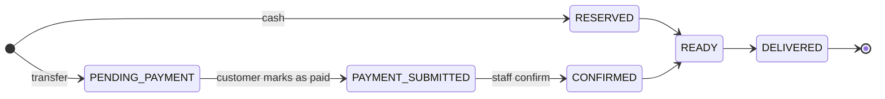

# Product Spec

> Name: **itacatl**. In Nahuatl, *itacatl* is the food you carry for the road ("despensa para el camino", Molina 1571; see the [Gran Diccionario Náhuatl](https://gdn.iib.unam.mx/diccionario/itacatl)). It is the root of the Mexican Spanish *itacate*. The production domain is not decided yet.

## Vision

An e-commerce platform for small Mexican businesses whose menu changes over time and whose stock runs out: *fondas* with a daily *comida corrida*, *neverías* with seasonal flavors, *pulquerías* with the *curados* of the day, a barbacoa stand that only opens on Sundays. Businesses publish their menu; customers find what they want, reserve it before it sells out, pay, and pick it up.

It works like a regular e-commerce. What makes it different is that menus are **dynamic**: they are valid for a specific service window and have limited stock.

**One deploy is one marketplace for one vertical** (fondas, neverías, pulquerías…), with many businesses inside. The vertical is configuration (branding, texts, categories, seed data), not code. The first vertical is fondas.

The project has three goals:

1. **Infrastructure:** clean, robust and as cheap as possible, so modest businesses can afford it. Ready to deploy, not kept running. See [infra-plan.md](infra-plan.md).
2. **Engineering showcase:** production-quality Java, Spring Boot and React.
3. **A real use case:** built around how these businesses actually operate in Mexico (changing menus, limited stock, cash or bank transfer, WhatsApp).

## Core flow

**Find → reserve → pay → pick up** (or eat on site, when the business allows it).

Every feature must make one of these steps better. Anything else goes to [Later](#later) or [Non-goals](#non-goals).

## Roles

| Role | Description |
|---|---|
| Platform admin | Manages the platform and the businesses registered on it |
| Business owner | Registers a business, manages its profile, schedule, menu, staff and settings |
| Business staff | Updates availability and handles orders (confirm payments, mark ready or delivered) |
| Customer | Browses menus and reserves orders. No account: name + WhatsApp-verified phone |

## Multi-tenancy

- One deployment hosts many businesses; each business is a tenant with its own menu, data and users.
- Shared database and schema with a `tenant_id` discriminator (Hibernate `@TenantId`).
- PostgreSQL Row-Level Security as a second layer of tenant isolation.

## Schedule and menus

- **Weekly schedule:** each business defines its service hours per day of the week (e.g. Sunday 8:00–14:00), plus date exceptions (closed on a holiday, a special opening).
- **A menu belongs to a service:** it is published for a specific date and time window, not just for "today". Customers can reserve in advance (e.g. Saturday for Sunday's barbacoa), from a per-business opening time for reservations.
- **Items:** each menu item has a price and a limited stock. A *comida corrida* combo (soup, rice or pasta, main dish, dessert, drink of the day) is one item with its courses listed, not a special menu structure.
- **Fast, mobile-first editing for owners:**
  - Duplicate a previous menu.
  - Pick from a catalog of recurring items.
  - Mark an item as sold out in one tap.
- **Real-time availability for customers** (SSE or WebSockets), e.g. "3 portions of mole left".
- **Sharing:** shareable link and image for WhatsApp.
- **Alcohol:** items can be flagged as alcoholic for display. Verifying the customer's age is the business's responsibility, not the app's.

## Discovery (customer)

- Browse menus of open or upcoming services across businesses. A closed business shows when it opens next instead of disappearing.
- Full-text search over menu items in Spanish ("who has chiles rellenos today?").
- Filter by distance (PostGIS), price, and time ("open now", "today", "this weekend").

## Orders

### Fulfillment

Each business chooses what it accepts: pickup, eating on site, or both. The customer picks one when reserving. The order flow is the same; the window is an arrival window either way.

### Payment methods, configurable per business

1. **Cash on pickup:** the order holds stock for a pickup window (e.g. 1 h). If it is not picked up, it expires and the stock returns to the menu.
2. **Bank transfer (SPEI):**
   - The app shows the business's CLABE and a unique order reference to use as the transfer concept.
   - The customer marks the order as paid.
   - Staff confirm the payment.

### Order states

Any active state can also move to `EXPIRED` or `CANCELLED`, and the held stock returns to the menu.

### Rules

- **Computed availability:** available = total − sold − active holds (`expires_at > now`). Expiry is correct even if no background job runs on time. A scheduled job only updates states and sends notifications.
- **Concurrency:** optimistic locking prevents holding stock that no longer exists.
- **Per-business time windows:** how long the customer has to submit a transfer and how long to pick up.
- **Abuse protection:** a limit on active orders per phone number and a no-show history per customer.

## Customer identity

- No account: name + phone number verified through a WhatsApp one-time code.
- **OTP rules:**
  - The code is stored hashed, expires after 5 minutes and allows only a few attempts.
  - Sends are rate limited per phone and per IP, with a global daily cap.
- Phone numbers are normalized to E.164 (`+52…`).
- After verification, a session token is issued for about 30 days.

## Notifications

- **Notification port** with a single adapter for now: WhatsApp (Meta Cloud API).
- **Use cases:**
  - OTP codes.
  - Order status updates.
- **Cost:** WhatsApp charges per message, so sends are capped (see the OTP rules above).
- **Local profile:** OTP codes are logged instead of sent, so the app can be tried without a WhatsApp Business account.

## Internationalization

Code, API, logs and docs are in English; deployments serve their users in their own language, Spanish (`es-MX`) first. The rule is that nothing a user reads is hardcoded.

- **Frontend:** `react-i18next`, one JSON catalog per locale (`en`, `es-MX`) with English keys grouped by screen. A test fails when the catalogs do not have the same keys.
- **API errors:** stable codes (e.g. `ITEM_SOLD_OUT`) plus parameters, never sentences; the client translates them.
- **Server-generated text** (WhatsApp messages): Spring `MessageSource` bundles, rendered in the customer's locale.
- **Formatting:** numbers, prices and dates go through locale-aware formatters (`Intl` in the browser), never string concatenation.
- **Locale selection:** each deployment sets a default locale, like the vertical; users can switch, and the choice is remembered.
- **Business content** (menu items, descriptions) is stored as the business writes it, not machine-translated.

## Mexico-specific defaults

- Currency: MXN.
- Time zone: `America/Mexico_City`. Schedules are stored as local times plus a zone ID, never as fixed offsets.
- Default locale: `es-MX` (see [Internationalization](#internationalization)).

## Sample data

`docker compose up` seeds sample businesses and menus, so the whole flow can be tried locally.

## Later

Planned once the core flow, security and infrastructure are solid:

- **Discovery with INEGI DENUE:** list businesses that have no menu in the app (name, location, SCIAN activity, e.g. `722511` for *comida corrida*), with a "see on Google Maps" link. They can claim their profile and start publishing menus. DENUE is free open data with a token-based API; Google Places was discarded for cost. Seed files committed to this repository must never include DENUE contact fields (phones, emails). Rate limits, license and update frequency still need to be checked.
- Subscriptions: a message with the new menu from favorite businesses (opt-in). WhatsApp likely bills it as a marketing template, the most expensive category.
- More notification adapters: Telegram, email (SES), web push.
- Upload of the transfer receipt.
- Payment gateway (Mercado Pago or CoDi), as another adapter behind a payment port.

## Non-goals

- Delivery.
- Table management: seat reservations, waitlists, ordering from the table.
- Reviews, ratings and loyalty programs.
- Recurring calendar rules beyond a weekly schedule plus date exceptions.
- Age verification.

## Open questions

- Production domain.
